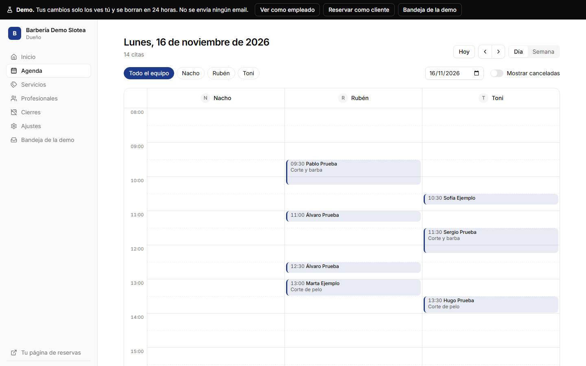
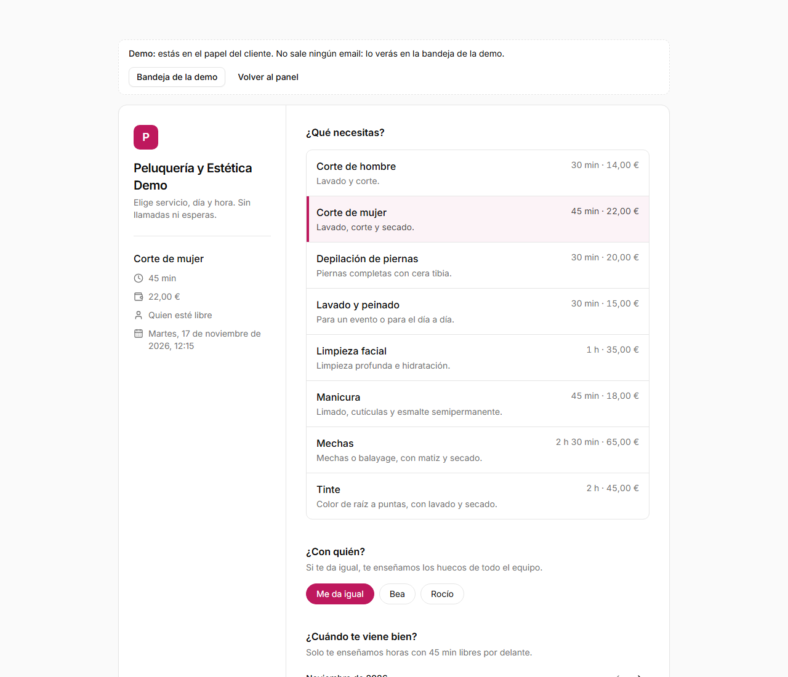
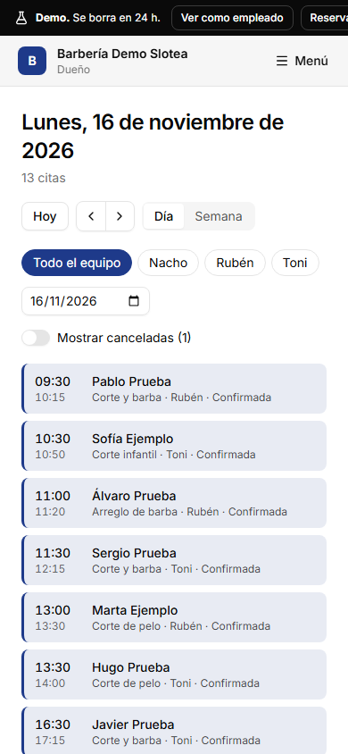
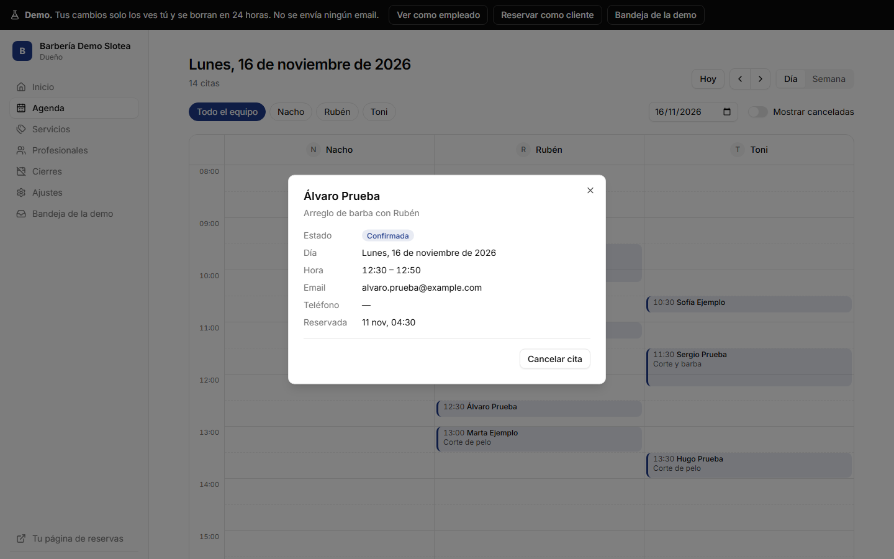
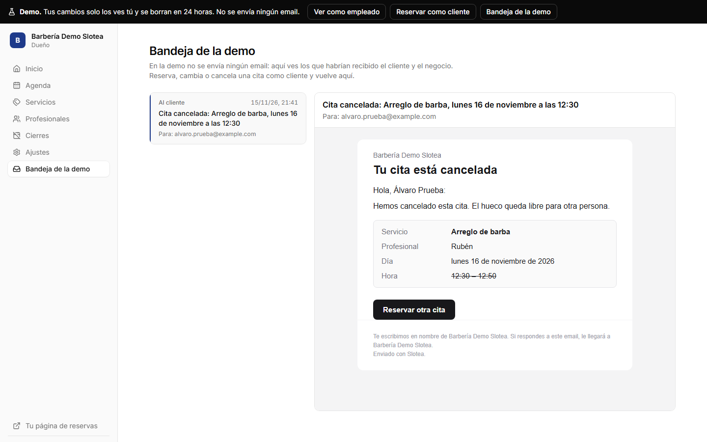
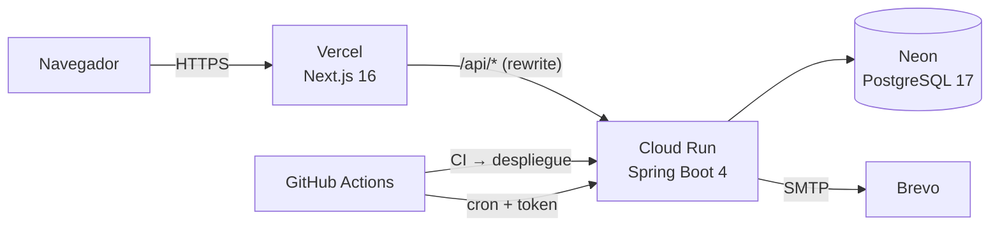

# Slotea

Reservas de citas para pequeños negocios: una **página de reservas** con el color de cada negocio, una
**agenda** para el dueño y otra para cada persona del equipo, y **emails** con un enlace para cambiar o
cancelar la cita. Multi-tenant: muchos negocios en la misma aplicación, sin que ninguno vea nada de otro.

**[Pruébalo en slotea.vercel.app](https://slotea.vercel.app)**: elige un sector (barbería, peluquería,
taller, psicología, fisioterapia o veterinaria) y entra como negocio, como empleado o como cliente. Sin
registrarte: cada visitante tiene su propia copia, con la agenda llena, que se borra a las 24 h.



| Página de reservas | Agenda en el móvil |
|---|---|
|  |  |

| Una cita | La bandeja de la demo |
|---|---|
|  |  |

## Lo interesante

- **Nunca dos citas en el mismo hueco.** Lo garantiza una restricción `EXCLUDE USING gist` de PostgreSQL,
  no el código: un test lanza 20 reservas simultáneas del mismo hueco contra PostgreSQL real
  (Testcontainers) y exige 1 éxito y 19 respuestas 409. Los tests también destaparon *deadlocks* entre
  inserciones simultáneas, resueltos con una cola por profesional. → [ADR 0003](docs/adr/0003-doble-reserva-en-la-base-de-datos.md)
- **Aislamiento entre negocios en tres capas:** `@TenantId` de Hibernate, claves foráneas compuestas
  `(business_id, id)` y un test de aislamiento por endpoint. → [ADR 0002](docs/adr/0002-multi-tenant-esquema-compartido.md)
- **Huecos en la zona horaria del negocio**, guardados en UTC, con tests del cambio de hora.
- **Sesión que un XSS no puede robar:** JWT de 15 min y refresh rotatorio con detección de robo, en
  cookies `httpOnly`. El navegador solo habla con Vercel, sin CORS. → [ADR 0004](docs/adr/0004-sesion-jwt-en-cookie.md)
- **Ningún email perdido ni enviado de más:** outbox en la misma transacción que la cita, envío después
  del commit y reintentos desde un cron. → [ADR 0005](docs/adr/0005-emails-con-outbox.md)
- **Producción a coste cero que no se cae sin avisar:** Cloud Run + Neon + Vercel, despliegue automático
  con la CI en verde, prueba de humo diaria y latido semanal del email. → [ADR 0009](docs/adr/0009-alojamiento-gratuito-portable.md)
- **Calidad comprobada, no prometida:** tests de punta a punta con Playwright contra la app de verdad,
  axe (WCAG 2.2 AA) en todas las páginas, CSP y límites de peticiones. → [Fase 10](docs/fase-10-calidad.md)

## Arquitectura



- Monorepo: `apps/api` (API REST organizada por funcionalidad), `apps/web` (Next.js), `infra/`, `docs/`.
- REST en `/api/v1`, errores en `ProblemDetail` (RFC 9457). El contrato es el OpenAPI de springdoc y los
  tipos de TypeScript se generan desde él; la CI falla si se desincronizan.
- La API escala a cero, así que no hay `@Scheduled`: los trabajos periódicos los lanza un cron de GitHub
  Actions contra `/internal/jobs/*`. → [ADR 0006](docs/adr/0006-jobs-desde-un-cron-externo.md)

## Stack

| Parte | Tecnología |
|---|---|
| API | Java 25 · Spring Boot 4.1 · Spring Security 7 · Spring Data JPA (Hibernate 7) · Flyway · springdoc-openapi |
| Base de datos | PostgreSQL 17 |
| Web | Next.js 16 (App Router) · TypeScript · Tailwind 4 + shadcn/ui · TanStack Query · react-hook-form + Zod |
| Tests | JUnit + Testcontainers · Vitest + Testing Library + MSW · Playwright + axe |
| Infra | Docker · GitHub Actions · Cloud Run · Neon · Vercel · Brevo |

## Decisiones y diseño

- [Decisiones de arquitectura (ADR)](docs/adr/README.md)
- [Análisis inicial: alojamiento, versiones, modelo de datos](docs/fase-1-analisis.md)
- [Sesión y aislamiento entre negocios](docs/fase-4-identidad.md)
- [Catálogo: servicios, profesionales, horarios y cierres](docs/fase-5-catalogo.md)
- [Disponibilidad y reservas sin doble reserva](docs/fase-6-reservas.md)
- [Emails (outbox) y gestión de la cita por enlace](docs/fase-7-emails.md)
- [Agenda del negocio y avisos](docs/fase-8-agenda.md)
- [Demo en un clic](docs/fase-9-demo.md)
- [Calidad: límites, seguridad, E2E y accesibilidad](docs/fase-10-calidad.md)
- [Despliegue](infra/)

## Arrancar en local

Requisitos: JDK 25, Node 26, pnpm y Docker.

```bash
cp .env.example .env                          # pon POSTGRES_PASSWORD, JWT_SECRET y LINK_SECRET (openssl rand -base64 48)
cp apps/web/.env.example apps/web/.env.local
docker compose up -d                          # PostgreSQL + Mailpit (emails en http://localhost:8025)

cd apps/api && ./mvnw spring-boot:run         # API en http://localhost:8080 (Swagger en /swagger-ui.html)
cd apps/web && pnpm install && pnpm dev       # Web en http://localhost:3000
```

## Tests

```bash
cd apps/api && ./mvnw verify                          # unitarios + integración contra PostgreSQL real (Testcontainers)
cd apps/web && pnpm lint && pnpm typecheck && pnpm test
cd apps/web && pnpm exec playwright install chromium && pnpm e2e   # con la API y la web arrancadas
```

Si cambias la API, actualiza el contrato y los tipos de la web:

```bash
cd apps/api && ./mvnw test -Dtest=OpenApiContractTests -Dopenapi.update=true   # → apps/web/openapi.json
cd apps/web && pnpm api:types                                                  # → src/lib/api/schema.d.ts
```

Las capturas de este README se generan con `pnpm screenshots` (Playwright).
